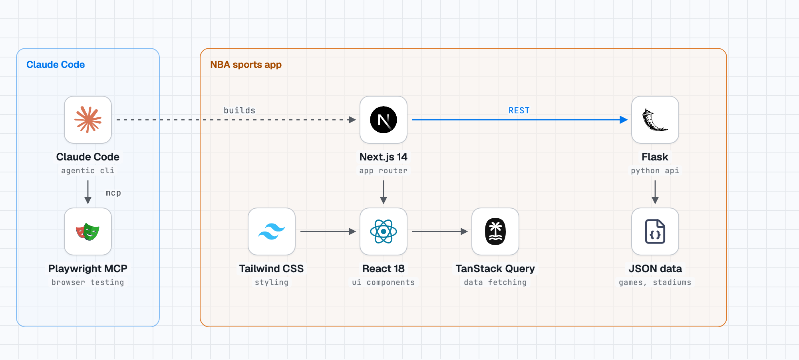

# Claude Code Workshop - NBA Sports Application

<!-- stack-diagram:start -->
<picture>
  <source media="(prefers-color-scheme: dark)" srcset="docs/stack-diagram-dark.png">
  
</picture>
<!-- stack-diagram:end -->


Welcome to the comprehensive **Claude Code Workshop**! This hands-on workshop teaches you to leverage AI-powered development with **Claude** (Anthropic's Claude Code) through a real NBA sports application built with **Next.js 14 (Frontend)** and **Python Flask (Backend)**.

> This workshop is a Claude-focused adaptation of the [GitHub Copilot Workshop by yoavlax](https://github.com/yoavlax/githubcopilotworkshop). Every exercise has been re-tooled around Claude Code — its agentic default loop, `CLAUDE.md` memory, subagents, slash commands, Agent Skills, MCP, plan mode, and checkpoints. If you've done the Copilot version, you'll recognize the app and the goals; the *how* is what changes. See [Credits](#-credits--acknowledgments) below.

❗**Note**: No mastery of JavaScript, Python, or Next.js is needed — Claude will generate most of the code for you in this exercise. Even if you're not very familiar, it's a great opportunity to leverage AI to quickly learn popular frameworks.

## 🎯 Workshop Objectives

By the end of this workshop, you'll master:
- **Core Claude Code Features**: Natural-language codebase exploration, project memory (`CLAUDE.md`), and inline editing
- **Agentic Workflows**: Claude Code's default agent loop, plan mode, checkpoints/rewind, and vision
- **Extensibility**: Custom subagents, slash commands, Agent Skills, plugins, and MCP servers
- **Automation**: Claude Code on the web, GitHub Actions (`@claude`), and headless mode
- **Best Practices**: Error handling, testing, documentation, and code review with Claude

## 🤖 Why Claude Code (vs. an in-editor autocomplete)

Claude Code is a **terminal-native, fully agentic coding tool**. Instead of an editor plugin that mainly suggests completions and answers chat questions, Claude Code plans multi-step work, reads and edits files across your repo, runs commands and tests, and iterates on its own errors — all from a conversation. It runs in your terminal, in VS Code / JetBrains (via the extension), on the web, and in CI.

A few conceptual mappings if you're coming from GitHub Copilot:

| GitHub Copilot | Claude Code equivalent |
| --- | --- |
| `.github/copilot-instructions.md` | `CLAUDE.md` (project memory, auto-loaded) |
| `@workspace` / `#codebase` | Claude reads your project automatically; `@path/to/file` to attach a specific file |
| Ask / Edit / **Agent** modes | Claude Code is agentic by default; toggle **Plan mode** with `Shift+Tab` |
| `/explain`, `/doc`, `/fix` | Just ask in natural language, or define your own `/slash-commands` |
| Model selector (GPT / Claude) | `/model` → Opus 4.8, Sonnet, Haiku |
| `.github/agents/*.agent.md` | `.claude/agents/*.md` (subagents) |
| `.github/prompts/*.prompt.md` | `.claude/commands/*.md` (slash commands) |
| `.github/skills/*/SKILL.md` | `.claude/skills/*/SKILL.md` (Agent Skills) |
| Chat rollback | `Esc Esc` / `/rewind` (checkpoints) |
| Copilot code review | `/review`, `/security-review` |
| AI Contribution Tracker | `/cost`, `/usage`, `/context` |
| Vision (attach image) | Drag, paste, or reference an image path |
| MCP servers (tools icon) | `claude mcp add …` / `.mcp.json` |
| Copilot Coding Agent (assign issue) | Claude Code on the web, GitHub Actions, `@claude` |
| Copilot CLI | Claude Code **is** the CLI |
| Marketplace extensions | Plugins & marketplaces (`/plugin`) |

## 📋 Prerequisites

### Required
1. **Claude access**: A Claude account. Claude Code works with a **Claude Pro/Max** subscription or an **Anthropic API** key (Console). See [Set up Claude Code](https://code.claude.com/docs/en/setup).
2. **Claude Code installed**: Install the CLI (see Task 0). Optionally install the **VS Code / JetBrains extension** for an in-editor experience.
3. **Frontend Runtime**: Install [Node.js](https://nodejs.org/en/download) & npm. Verify with:
   ```bash
   node -v
   npm -v
   ```
4. **Backend Runtime**: Install [Python 3.8+](https://www.python.org/downloads/) & pip. Verify with:
   ```bash
   python --version
   pip --version
   ```

### Optional for Advanced Features
- **Docker** (for some MCP servers)
- **A GitHub account** (for the GitHub MCP server and the GitHub Actions task)

## 💻 Getting the Code (First-Timer Friendly)

New to GitHub, the terminal, or VS Code? This section walks you through getting the project onto a **Mac** and opening it. (The rest of the workshop's commands work the same on macOS and Linux; Windows equivalents are noted where they differ.)

### Step 1 — Download the repo

There are two ways. Cloning (Option B) is recommended for the workshop because you can pull updates later, but the ZIP is the simplest if you just want the files.

**Option A — Download as a ZIP (no tools needed)**
1. Open the repo page in your browser: `https://github.com/9q4kt8t4df-byte/claude-vscode-workshop`
2. Click the green **`< > Code`** button (top right).
3. Click **Download ZIP**.
4. Find the `.zip` in your **Downloads** folder and double-click it to unzip. You'll get a `claude-vscode-workshop` folder — drag it somewhere memorable like **Documents**.

**Option B — Clone with Git (recommended)**

Cloning downloads the code *and* keeps it linked to GitHub. It uses the **Terminal** app (macOS's command-line tool).

1. **Open Terminal:** press `Cmd + Space`, type **Terminal**, press Return.
2. **Check that Git is installed:**
   ```bash
   git --version
   ```
   If you see a version number, you're set. If not, macOS will offer to install the "command line developer tools" — click **Install**, wait, then try again.
3. **Go to where you want the folder to live** (`cd` = "change directory"; `~` = your home folder):
   ```bash
   cd ~/Documents
   ```
4. **Clone the repo:**
   ```bash
   git clone https://github.com/9q4kt8t4df-byte/claude-vscode-workshop.git
   ```
5. **Move into the folder** and list its contents:
   ```bash
   cd claude-vscode-workshop
   ls
   ```
   You should see `README.md`, `backend`, `frontend`, and more.

> **Note:** the repo must be **public** (or you must be signed in with access) for cloning to work without extra setup.

### Step 2 — Open the folder in VS Code

VS Code works best when you open the **whole project folder** (it calls this a workspace), so it can see every file at once.

**From the menu (easiest):**
1. Open **VS Code**.
2. **File → Open Folder…**
3. Select `Documents → claude-vscode-workshop`, click **Open**.
4. If asked *"Do you trust the authors of the files in this folder?"*, click **Yes, I trust the authors** (it's your own code).

You'll now see the file tree on the left. Two handy shortcuts once you're comfortable:
- **Drag-and-drop** the folder from Finder onto the VS Code icon or window.
- **From Terminal:** run the *"Shell Command: Install 'code' command in PATH"* action once (press `Cmd+Shift+P` in VS Code and search for it), then you can type `code .` inside the folder to open it instantly.

### Step 3 — Start working with Claude Code

Because this is a **Claude Code** workshop, once the folder is open you have two ways to work:

1. **Claude Code extension** — install the *Claude Code* extension from VS Code's Extensions panel (the square icon in the left toolbar) for an in-editor chat and diff view. *(See Task 0.1.)*
2. **Integrated terminal** — open VS Code's built-in terminal with **Terminal → New Terminal** (or `` Ctrl+` ``), then run:
   ```bash
   claude
   ```
   This launches Claude Code inside the project and it automatically picks up the `CLAUDE.md` and `.claude/` configuration that ships with the repo.

> **VS Code isn't required.** Claude Code runs the same way in the plain macOS Terminal — just `cd` into the folder and run `claude`. VS Code simply adds a visual editor around it.

**Putting it together:** clone the folder → open it in VS Code → open the integrated terminal → set up and run the backend and frontend (**Task 0** below) → run `claude` and start **Task 1**.

## 🚀 Quick Start

This section is a condensed version of the steps above, for people who already know their way around a terminal. First-timers should follow **[Getting the Code](#-getting-the-code-first-timer-friendly)** and then **Task 0**.

1. **Clone the repository**
   ```bash
   git clone https://github.com/9q4kt8t4df-byte/claude-vscode-workshop.git
   cd claude-vscode-workshop
   ```

2. **Set up the Backend (Python Flask)**
   ```bash
   cd backend
   python -m venv venv

   # On Windows:
   venv\Scripts\activate

   # On macOS/Linux:
   source venv/bin/activate

   pip install -r requirements.txt
   python app.py
   ```
   Backend runs on http://localhost:8080

3. **Set up the Frontend (Next.js) — in a new terminal**
   ```bash
   cd frontend
   npm install
   echo "NEXT_PUBLIC_API_URL=http://localhost:8080" > .env.local
   npm run dev
   ```
   Frontend runs on http://localhost:3000

4. **Launch Claude Code** in the project root
   ```bash
   claude
   ```

> **Don't have the NBA sample app yet?** This repo ships the Claude-specific configuration (`CLAUDE.md`, `.claude/agents`, `.claude/commands`, `.claude/skills`). If the `backend/` and `frontend/` folders aren't present, **Task 0.5** shows you how to have Claude Code scaffold the app for you — a great first taste of the agentic loop.

## 🏀 Application Overview

**Claude NBA Companion** — your dedicated NBA companion! This app brings you:
- 📊 **Live NBA Results**: Game scores and statistics
- 🎯 **Player Information**: Player stats and profiles
- 🏟️ **Stadium Information**: NBA venues and facility details
- 👨‍🏫 **Coach Management**: NBA coaches and their achievements
- ⚡ **Performance Optimization**: Examples for code-optimization exercises
- 🔧 **Error Handling**: Debugging and error-resolution practice

## 🏗️ Architecture

A **separated frontend/backend architecture**:

### Backend (Python Flask)
- **Port**: 8080 — RESTful API providing all data endpoints
- CORS-enabled, JSON-based data storage, health check endpoint

### Frontend (Next.js 14)
- **Port**: 3000 — user interface and client-side logic
- App Router, TypeScript, Tailwind CSS, shadcn/ui, React Query

### Communication Flow
```
Browser (localhost:3000)
    ↓ HTTP Requests
Next.js Frontend
    ↓ API Calls (fetch)
Flask Backend (localhost:8080)
    ↓ JSON Response
Frontend renders data
```

## 📁 Project Structure

```
├── CLAUDE.md                  # Project memory — auto-loaded by Claude Code
├── .claude/
│   ├── agents/                # Custom subagents (plan, doc-updater, …)
│   ├── commands/              # Custom slash commands (reusable prompts)
│   └── skills/                # Agent Skills (e.g. webapp-testing)
├── .mcp.json                  # (optional) Project-scoped MCP servers
├── backend/                   # Python Flask Backend
│   ├── app.py                 # Main Flask application
│   ├── requirements.txt       # Python dependencies
│   └── data/                  # JSON data files (nba-games, stadiums, …)
├── frontend/                  # Next.js Frontend
│   ├── src/
│   │   ├── app/(dashboard)/   # nba-scores, stadiums, optimization, errors …
│   │   ├── components/        # UI components (shadcn/ui under ui/)
│   │   ├── lib/ · hooks/ · util/
│   └── package.json
└── image/                     # Workshop assets
```

---

# 📖 Workshop Instructions

## Task 0 - Install Claude Code & Choose a Model
`⏱ ~15 min | 🟢 Beginner`

### 0.1 Install Claude Code

Pick **one** of the methods below — they all install the same `claude` command, just via different package managers.

**npm (all platforms):**
```bash
npm install -g @anthropic-ai/claude-code
```
`-g` installs it **globally**, so you can run `claude` from any folder (not just this project). Choose this if you already have Node.js/npm.

**macOS/Linux/WSL (native installer):**
```bash
curl -fsSL https://claude.ai/install.sh | bash
```
This downloads Anthropic's install script and runs it — it fetches a standalone `claude` binary, so you don't need Node.js. (`curl` downloads the script; `| bash` pipes it straight into your shell to execute.)

**Windows (PowerShell):**
```powershell
irm https://claude.ai/install.ps1 | iex
```
The PowerShell equivalent of the line above: `irm` (Invoke-RestMethod) downloads the script and `iex` (Invoke-Expression) runs it.

Verify the install and run the built-in doctor:
```bash
claude --version    # prints the installed version — confirms `claude` is on your PATH
claude doctor       # health check: verifies the install, auth, and config are set up correctly
```

**IDE extension (optional but recommended):** Install the **Claude Code** extension for [VS Code](https://marketplace.visualstudio.com/items?itemName=anthropic.claude-code) or JetBrains. It gives you inline diffs, an in-editor chat panel, and shares the same `CLAUDE.md` / `.claude/` configuration as the CLI.

### 0.2 Authenticate

From your project directory, start Claude Code and follow the login flow:
```bash
claude
```
On first run you'll be prompted to sign in with your **Claude account** (Pro/Max) or an **Anthropic API key**. See [Set up Claude Code](https://code.claude.com/docs/en/setup) for details.

### 0.3 Environment Setup

The app has **two services that run at the same time**: a Python backend (the API/data) and a Next.js frontend (the web UI). You'll start each in **its own terminal window** and leave both running for the whole workshop — the frontend calls the backend over HTTP, so if either is stopped, the app won't work. Set up the backend first (the frontend needs it to answer requests).

#### Backend Setup (Python Flask) — Terminal 1

```bash
cd backend
python -m venv venv
# Windows:  venv\Scripts\activate
# macOS/Linux:  source venv/bin/activate
pip install -r requirements.txt
python app.py            # http://localhost:8080
```

Line by line — **what each step does and why**:
- `cd backend` — move into the backend folder so the following commands run against the Flask app.
- `python -m venv venv` — create a **virtual environment** (a private, project-local Python with its own packages) in a new `venv/` folder. *Why:* it keeps this project's dependencies isolated from your system Python and other projects, so nothing conflicts.
- `source venv/bin/activate` (or `venv\Scripts\activate` on Windows) — **activate** that virtual environment for this terminal. *Why:* after this, `python` and `pip` point at the project's isolated environment instead of your system-wide one. You'll know it worked when your prompt shows `(venv)`.
- `pip install -r requirements.txt` — install the exact Python packages the backend needs (Flask, Flask-CORS, …), as listed in `requirements.txt`. *Why:* the app can't run without its libraries.
- `python app.py` — start the Flask API server. *Why:* this is the backend. Leave it running; it serves data at **http://localhost:8080**.

**Verify it's up** (in a separate terminal, or your browser):
```bash
curl http://localhost:8080/api/health
```
A JSON response like `{"status": "healthy", ...}` means the backend is working.

#### Frontend Setup (Next.js) — Terminal 2

Open a **new** terminal (leave the backend running in the first one) and:

```bash
cd frontend
npm install
echo "NEXT_PUBLIC_API_URL=http://localhost:8080" > .env.local
npm run dev              # http://localhost:3000
```

Line by line — **what each step does and why**:
- `cd frontend` — move into the frontend folder.
- `npm install` — download the JavaScript/TypeScript packages listed in `package.json` into a local `node_modules/` folder. *Why:* the Next.js app needs its dependencies before it can run (this is the frontend equivalent of `pip install`).
- `echo "NEXT_PUBLIC_API_URL=http://localhost:8080" > .env.local` — create a file named `.env.local` containing one **environment variable** that tells the frontend where the backend lives. *Why:* the app reads `NEXT_PUBLIC_API_URL` at runtime instead of hard-coding the backend URL, so you can point it at a different backend later without editing code. The `>` just writes that line into the file (creating it if needed). You could also create `.env.local` by hand in your editor — the `echo` command is only a shortcut.
- `npm run dev` — start the Next.js **development server**. *Why:* this is the frontend. It serves the UI at **http://localhost:3000** and hot-reloads as you (or Claude) edit files. Leave it running.

Now open **http://localhost:3000** in your browser — you should see the app, and it should be pulling data from the backend on port 8080.

> 💡 **Mental model:** Terminal 1 = backend API (port 8080). Terminal 2 = frontend UI (port 3000). Your browser talks to 3000, and 3000 talks to 8080. Keep both terminals open for the whole workshop.

### 0.4 Choose Your Claude Model

Claude Code lets you switch models at any time with the **`/model`** slash command. Pick based on the task:

- **Claude Opus** (e.g. `claude-opus-4-8`): Deepest reasoning — best for complex, multi-file features, tricky debugging, architecture, and agent-mode work.
- **Claude Sonnet**: Excellent all-rounder — great for everyday development, UI components, API routes, refactors, and optimization. A strong default.
- **Claude Haiku**: Fastest & most economical — great for quick edits, simple lookups, and high-volume tasks.

**How to switch models:**
```
/model
```
Then pick from the list. You can change mid-session; Claude keeps the conversation context.

> 💡 **Tip:** Claude Code also supports **extended thinking**. Ask Claude to "think", "think hard", or "think harder" about a tough problem to allocate more reasoning budget before it acts.

### 0.5 (If needed) Scaffold the Sample App with Claude Code

If `backend/` and `frontend/` don't exist yet, let Claude build them — your first agentic task. In `claude`, try:
```
Scaffold a two-service NBA demo app described in CLAUDE.md:
1. A Python Flask backend in backend/ on port 8080 with JSON data files under
   backend/data/ (nba-games.json, stadiums.json, player-info.json, coaches.json)
   and REST endpoints: /api/health, /api/nba-results, /api/stadiums,
   /api/player-info, /api/coaches, and an intentionally slow /api/optimize.
2. A Next.js 14 (App Router, TypeScript, Tailwind, shadcn/ui) frontend in
   frontend/ on port 3000 with a (dashboard) route group containing
   nba-scores, stadiums, optimization, and errors pages, plus a sidebar nav.
Create everything step by step and let me review each step.
```
Watch Claude plan, create files, and wire the two services together. Accept or refine as it goes.

---

## Task 1 - Core Claude Code Basics
`⏱ ~45 min | 🟢 Beginner`

### 1.1 Repository Exploration

**Imagine you just joined the team and need to understand the project.**

Claude Code automatically has access to your working directory — no `@workspace` needed. Start `claude` in the project root and ask:
- `Can you tell me about this repository?`
- `What is the architecture of this application?`
- `Where is the backend API located and what framework is it using?`
- `Where is the frontend located and what framework is it using?`
- `How do the frontend and backend communicate?`
- `Which API endpoints are available in the backend?`
- `Where are the main UI components in the frontend?`
- `What packages does each service use?`

> 💡 To ground an answer in a specific file, reference it with `@`, e.g. `Explain @backend/app.py`. Type `@` to get file autocompletion.

### 1.2 Explore Technologies with Claude

Use Claude to learn the technologies in this project, grounded in the actual codebase. Ask these one by one:
- `How do API endpoints work in Flask? Show me an example from @backend/app.py`
- `What is the App Router pattern in Next.js 14? Where is it used in this project?`
- `How does this project handle CORS between frontend and backend?`
- `What is the difference between server and client components in Next.js 14? Are there examples here?`
- `How does the frontend fetch data from the backend API? Show me an example`

> **Tip:** Notice how Claude cites real files and line numbers because it can read the whole project. Compare that to a generic answer with no repo context.

### 1.3 Project Memory with `CLAUDE.md` (Custom Instructions)

Where Copilot uses `.github/copilot-instructions.md`, **Claude Code uses `CLAUDE.md`** — a memory file it loads automatically at the start of every session. Use it to encode your architecture, conventions, and expectations once so you don't repeat them in every prompt.

**Instructions:**
1. Open the `CLAUDE.md` file at the repo root (this workshop ships one — review it).
2. If you're starting from an empty repo, generate a first draft by running the built-in command inside `claude`:
   ```
   /init
   ```
   Claude will scan the project and propose a `CLAUDE.md`.
3. Confirm the file describes: the separated Next.js + Flask architecture, TypeScript/Tailwind/shadcn on the frontend, Flask/PEP 8 on the backend, and your code-generation guidelines (comments, error handling, loading states, responsive design).
4. Test it: ask Claude any coding question and notice it automatically applies these conventions — TypeScript for frontend, Python for backend, robust error handling, and proper architecture — without you restating them.

> 💡 **Memory tiers:** `CLAUDE.md` (project, shared via git), `CLAUDE.local.md` (project, personal/git-ignored), and `~/.claude/CLAUDE.md` (applies to all your projects). Add a quick note to memory mid-session by starting a message with `#`.

---
> **1.1–1.3: Exploration & Context** — Getting to know the project and configuring Claude's memory
---

### 1.4 Code Reviews with Claude

Claude can review code and suggest improvements — either conversationally or via the built-in `/review` command.

**Instructions:**
1. Open `backend/app.py`.
2. In `claude`, run:
   ```
   /review
   ```
   or ask directly: `Review the get_nba_results function in @backend/app.py for correctness, error handling, and best practices. Suggest concrete changes.`
3. Review Claude's feedback and apply the suggested improvements (Claude can apply them for you — just confirm the diff).
4. Repeat for the other API endpoint functions in the backend.

> 💡 For a security-focused pass, try `/security-review`.

### 1.5 Add Documentation Comments

Documenting code is tedious — let Claude help.

**Instructions:**
1. Open `backend/app.py`.
2. Ask Claude to explain a function first: `Explain the get_nba_results function in @backend/app.py step by step.`
3. Then generate docs: `Add a docstring and inline comments to the get_nba_results function following PEP 257. Keep behavior identical.`
4. Repeat for the other API endpoint functions.

**Notice:** Because your conventions live in `CLAUDE.md`, Claude applies them (style, comment density) automatically on every request.

> 💡 **In the IDE extension:** select the function in VS Code/JetBrains and ask Claude in the side panel — you'll see the documentation applied as an inline diff you can accept or reject.

### 1.6 Generate Unit Tests

**Instructions:**
1. Open `frontend/src/util/calculator.js` — simple calculator utilities.
2. In `claude`, run the workshop's custom command (see `.claude/commands/testing-strategy.md`):
   ```
   /testing-strategy @frontend/src/util/calculator.js
   ```
   or ask: `Generate Jest unit tests for all functions in @frontend/src/util/calculator.js and write them to frontend/src/util/calculator.test.js`.
3. From the `frontend` directory, run: `npm test src/util/calculator.test.js`
4. If tests fail, paste the terminal error back to Claude: `These tests fail with: <error>. Fix them.` Claude will iterate until they pass — and can run the tests itself if you let it.

### 1.7 Fix a Bug with Claude

Claude analyzes context to find and fix errors — and, in its agentic loop, can reproduce, patch, and verify.

**Instructions:**
1. Navigate to the errors page at http://localhost:3000/errors (an "Add NBA player" page).
2. Fill in the form and click **Create player** — you'll get a **404**; the API endpoint wasn't found.
3. Ask Claude: `The /errors page (@frontend/src/app/(dashboard)/errors/page.tsx) posts to /api/players but returns 404. Investigate why.`
4. The frontend POSTs to `/api/players` — does that route exist in `@backend/app.py`?
5. **Find the bug:** there's a mismatch between the backend route name and what the frontend calls.
6. Ask Claude to `Fix the route name in backend/app.py so it matches the frontend request, then explain the change.`
7. Restart the backend and test the form — you should see **"Player created successfully!"**
8. Bonus: `Rename the "errors" page to something descriptive like "add-player", updating the route, nav link, and any references.` Watch Claude update every touchpoint.

### 1.8 Create the Player Info Feature

Build a player-information display by attaching the relevant files as context.

**Instructions:**
1. Reference the API shape and data:
   - `@backend/app.py` — look at `get_player_info`
   - `@backend/data/player-info.json` — the players data
2. Ask Claude:
   ```
   Create a new Next.js page at frontend/src/app/(dashboard)/players-info/page.tsx that
   fetches player data from ${process.env.NEXT_PUBLIC_API_URL || 'http://localhost:8080'}/api/player-info.
   Display each player in its own card showing only id, name, team, weight, height, and
   position. Use Tailwind CSS and shadcn/ui. Handle loading and error states.
   ```
3. Open http://localhost:3000/players-info and verify results.

### 1.9 Optimize Code with Claude

Claude can refactor for performance without changing behavior.

**Instructions:**
1. Ensure both services are running (backend on 8080, frontend on 3000).
2. Open the **Optimization** page in the app's left menu — it's intentionally slow.
3. Find the backend route serving it: `@backend/app.py`, the `/api/optimize` endpoint.
4. Switch to a strong model for this: `/model` → **Claude Opus** (or keep Sonnet).
5. Ask: `The /api/optimize endpoint in @backend/app.py is intentionally slow. Optimize it to improve performance without changing its output. Explain what you changed and why.`
6. Apply the changes, restart the backend, and reload the page — it should load faster. The page prints execution time for comparison.

> ✅ **Task 1 Checkpoint:** You should have documented backend functions, passing calculator unit tests, a working `/players-info` page, and a faster `/api/optimize` endpoint.

---

## Task 2 - Intermediate Claude Code Features
`⏱ ~20 min | 🟡 Intermediate`

### 2.1 Custom Subagents

Where Copilot uses `.agent.md` files, **Claude Code uses subagents** — specialized assistants defined in `.claude/agents/*.md` with their own description, tools, and (optionally) model. Claude can delegate to them automatically, or you can invoke them explicitly.

**Instructions:**
1. **Explore the shipped subagents:** open `.claude/agents/plan.md` and `.claude/agents/doc-updater.md` to see the frontmatter format (`name`, `description`, `tools`, optional `model`).
2. **List them** from inside `claude`:
   ```
   /agents
   ```
   (Use `/agents` to view, create, and edit subagents interactively.)
3. **Create your own reviewer subagent** — add `.claude/agents/reviewer.md`:
   ```markdown
   ---
   name: reviewer
   description: Thorough code reviewer focused on best practices and maintainability. Use proactively after code changes.
   tools: Read, Grep, Glob
   ---

   You are a thorough code reviewer focused on best practices and maintainability.

   When reviewing:
   - Prefer single quotes in TypeScript
   - Check for proper error handling
   - Ensure consistent formatting
   - Verify accessibility standards
   - Look for performance optimizations
   - Suggest improvements for readability

   Report findings as a concise, prioritized list.
   ```
4. Invoke it: `Use the reviewer subagent to review my recent changes to backend/app.py.`

**Why subagents are powerful:** each runs in its **own context window** (keeping your main conversation clean), can be restricted to specific tools, and encodes repeatable, team-shareable expertise.

### 2.2 Reusable Prompts as Slash Commands

Copilot's `.prompt.md` files map to **Claude Code custom slash commands** in `.claude/commands/*.md`. The filename becomes the command name.

**Instructions:**
1. **Explore the shipped command:** open `.claude/commands/testing-strategy.md` — running `/testing-strategy` invokes it.
2. **Create a custom command** — add `.claude/commands/api-security.md`:
   ```markdown
   ---
   description: Secure REST API review checklist
   ---
   Perform a secure REST API review of $ARGUMENTS:
   - Ensure all endpoints enforce authentication and authorization
   - Validate all user inputs and sanitize data
   - Implement rate limiting and throttling
   - Add logging and monitoring for security events

   Report issues as a prioritized checklist with concrete fixes.
   ```
3. Test it: `/api-security @backend/app.py`

> 💡 `$ARGUMENTS` (and `$1`, `$2`, …) let commands take parameters. Commands can live in `.claude/commands/` (project, shared) or `~/.claude/commands/` (personal, all projects). Browse community commands and agents in the [Claude Code docs](https://code.claude.com/docs/en/slash-commands) and marketplaces.

### 2.3 Checkpoints, Rewind, and Prompt Editing

Copilot's "chat rollback" maps to **Claude Code checkpoints**. Claude automatically snapshots your codebase before each change so you can undo both the conversation *and* the file edits.

**Instructions:**
1. Ask Claude to create a simple NBA player card component.
2. To rewind, press **`Esc` twice** (`Esc Esc`) or run **`/rewind`**, then pick a checkpoint to restore code and/or conversation to that point.
3. Edit your earlier prompt to request more (e.g. "also add player statistics and hover effects") and re-run.
4. Try a different model first with `/model` (e.g. switch Sonnet ↔ Opus) and compare the results.

**Why this is powerful:** non-linear, low-risk experimentation — try an approach, rewind if you don't like it, adjust the prompt or model, and go again without losing your place.

> ✅ **Task 2 Checkpoint:** You should have a working `reviewer` subagent, a reusable `/api-security` command, and hands-on experience with `/rewind`.

---

## Task 3 - Agentic Development, Cost Tracking & Vision
`⏱ ~30 min | 🟡 Intermediate`

Claude Code is **agentic by default** — it plans, edits across files, runs commands, and fixes its own errors. For bigger tasks, use **Plan mode** (`Shift+Tab` to cycle modes) so Claude proposes a plan you approve *before* it edits.

### 3.1 Add the Stadiums Feature (Agentic)

**Instructions:**
1. Ensure both backend and frontend are running.
2. In `claude`, press `Shift+Tab` until you see **plan mode** (optional but recommended), then prompt:
   ```
   Let's add an NBA Stadiums page.

   1. Verify whether the backend stadiums endpoint already exists in backend/app.py
      (it should return data from backend/data/stadiums.json); add it if missing.
   2. Create frontend/src/app/(dashboard)/stadiums/page.tsx that fetches from
      ${process.env.NEXT_PUBLIC_API_URL || 'http://localhost:8080'}/api/stadiums.
   3. Display stadiums as cards showing name, location, capacity, and team.
   4. Add a nav link in frontend/src/components/navigation.tsx.
   5. Style with Tailwind CSS and shadcn/ui.

   Implement step by step and let me review each step.
   ```
3. **Agentic prompt tips:** be specific with file paths, number your steps, name the tech (Next.js 14, TypeScript, Tailwind, shadcn/ui, Flask, Python), and ask Claude to proceed incrementally.
4. Review the live diffs, accept/reject each change, then open http://localhost:3000 to verify the Stadiums tab works.

### 3.2 Track AI Usage & Cost

Claude Code has built-in visibility into token usage and (for API-key users) cost.

**Instructions:**
1. Run `/cost` to see token usage and estimated cost for the current session.
2. Run `/context` to visualize how your context window is being used (files, tools, memory).
3. Run `/usage` to check plan usage/limits (Pro/Max).
4. Use this to build intuition for prompt efficiency and when to `/clear` or `/compact` a long session.

> 💡 `/compact` summarizes and shrinks a long conversation; `/clear` starts fresh. Both help you stay within the context window on big tasks.

### 3.3 Build UI from an Image (Vision)

Claude can see images. Give it a screenshot or mockup and ask it to build the UI.

**Instructions:**
1. Add an image to the chat — drag & drop it into the terminal, paste it (`Ctrl+V`), or reference a path: `Build a React login component based on @image/login.png`.
   (Replace `image/login.png` with an actual login-screen mockup.)
2. Prompt:
   ```
   Build a React (Next.js + Tailwind + shadcn/ui) login component that matches this image.
   Track your progress with a todo list and implement it step by step.
   ```
3. Integrate the generated component into the app and verify it in the browser.

> ✅ **Task 3 Checkpoint:** You should have a working `/stadiums` page fed by the backend, a login component generated from an image, and familiarity with `/cost` and `/context`.

---

## Task 4 - MCP Servers & Agent Skills
`⏱ ~30 min | 🔴 Advanced`

**MCP (Model Context Protocol)** is the open standard for connecting Claude to external tools and data sources. Claude Code can use MCP servers for GitHub, browser automation (Playwright), databases, issue trackers, and more.

### 4.1 Add MCP Servers

An MCP server is a small program that exposes extra tools to Claude. There are two kinds you'll add here: a **remote** server Claude reaches over the web (GitHub), and a **local** server that runs as a command on your machine (Playwright). The `claude mcp add` command registers one so Claude Code can use it.

```bash
# GitHub (remote, OAuth) — great for issues/PRs/repos
claude mcp add --transport http github https://api.githubcopilot.com/mcp

# Playwright (local, via npx) — browser automation & E2E testing
claude mcp add playwright -- npx -y @playwright/mcp@latest
```

**Reading these commands — what each piece means and why:**
- `claude mcp add <name> …` — register a new MCP server under a short `name` (here `github` / `playwright`) that you'll see in `/mcp`.
- `--transport http` (first command) — tells Claude to talk to this server over **HTTP** at the given URL, because GitHub's MCP server is **remote/hosted**. *Why:* remote servers are reached by URL, not launched locally. (The default transport is `stdio` — a local command — which is why the second command doesn't need this flag.)
- `-- npx -y @playwright/mcp@latest` (second command) — everything **after the `--`** is the command Claude runs to start the server locally. *Why the `--`?* it separates `claude`'s own options from the command-to-run, so flags like `-y` are passed to `npx`, not misread by `claude`. Here `npx -y @playwright/mcp@latest` downloads (if needed) and runs the Playwright MCP server on demand.

Inside `claude`, manage and inspect servers with:
```
/mcp
```
Use `/mcp` to see connected servers, authenticate (the GitHub **OAuth** browser sign-in happens here), and view the tools each server provides. **Scope** controls who shares the server: `--scope local` (default — just you, this project), `--scope project` (shared with your team via a committed `.mcp.json`), `--scope user` (you, across all your projects).

> 💡 A project-scoped `.mcp.json` lets your whole team share the same MCP setup. Commit it to the repo.

### 4.2 End-to-End Testing with the Playwright MCP

**Goal:** test your NBA app's critical flows without writing test code.

**Instructions:**
1. Ensure the app is running (`npm run dev`).
2. With the Playwright MCP connected, ask Claude:
   ```
   Using the Playwright MCP, test this flow:
   1. Navigate to http://localhost:3000
   2. Click "NBA Scores" in the navigation
   3. Verify game scores are displayed
   4. Click "Stadiums"
   5. Verify stadium cards render
   6. Take a screenshot of each page
   7. Report pass/fail results
   ```
3. Review the automated run and screenshots; ask Claude to fix any failures or improve coverage.

### 4.3 Working with Agent Skills

**Agent Skills** are Anthropic's open standard for packaging repeatable expertise. Claude Code auto-discovers skills in `.claude/skills/<name>/SKILL.md` and loads them **only when relevant** (progressive disclosure), keeping context lean.

This workshop ships a **WebApp Testing** skill at `.claude/skills/webapp-testing/SKILL.md`.

**When to use it:** testing user flows, verifying components render, checking navigation, capturing screenshots, generating test reports, and regression testing after changes.

**How to use it:**
1. Start the app: `npm run dev`
2. Ensure the Playwright MCP is connected (`/mcp`).
3. Just describe the testing task — Claude will discover and apply the skill automatically:
   ```
   Test the complete user flow of the NBA app: open the home page, navigate to
   NBA Scores and verify scores show, go to Stadiums and verify cards render,
   screenshot each page, and give me a pass/fail report.
   ```
4. Manage installed skills from inside `claude` with `/skills` (or via plugins).

**Create your own skill:**
```bash
mkdir -p .claude/skills/my-custom-skill
```
```markdown
---
name: my-custom-skill
description: Brief description of what this skill does and when Claude should use it.
---

# My Custom Skill

Detailed instructions on when and how to perform this task...
```
Add supporting scripts/templates alongside `SKILL.md`, then commit it so your whole team benefits.

**Learn more:**
- 📖 [Claude Docs: Agent Skills](https://code.claude.com/docs/en/skills)
- 🔬 [Anthropic Skills Repository](https://github.com/anthropics/skills)
- 🌐 [Model Context Protocol](https://modelcontextprotocol.io)

> ✅ **Task 4 Checkpoint:** You've connected at least one MCP server and run an automated, skill-driven test flow against the running NBA app.

---

## Task 5 - Claude Code on the Web & GitHub Actions
`⏱ ~15 min | 🟡 Intermediate`

Claude can pick up work asynchronously — from a GitHub issue or PR, or from the web — and open pull requests for you.

### Option A — Claude Code on the web
1. Go to [claude.ai/code](https://claude.ai/code), connect your GitHub, and select this repository.
2. Describe a task, e.g. *"Create a dark-mode toggle in the top-right corner of the app."*
3. Claude runs in an isolated cloud environment, implements the change on a branch, and opens a **pull request** you review. See [Claude Code on the web](https://code.claude.com/docs/en/claude-code-on-the-web).

### Option B — GitHub Actions (`@claude`)
1. Install the Claude GitHub App and add your `ANTHROPIC_API_KEY` as a repo secret. The fastest path: run `/install-github-app` from inside `claude`, or follow [Claude Code GitHub Actions](https://code.claude.com/docs/en/github-actions).
2. Create an issue, e.g.:
   - **Title:** `Create dark mode toggle for this web app`
   - **Body:** `Add a dark-mode toggle in the top-right corner of every page. @claude please implement this.`
3. Mentioning **`@claude`** in an issue or PR comment triggers the Action; Claude implements the change and opens/updates a PR.
4. Review the diff and merge or refine.

> ✅ **Task 5 Checkpoint:** You have an open PR created by Claude. Review the diff, then merge or close it.

---

## Task 6 - Extend Claude Code with Plugins
`⏱ ~10 min | 🟢 Beginner`

Copilot's marketplace extensions map to **Claude Code plugins** — bundles of slash commands, subagents, skills, hooks, and MCP servers you can install from a marketplace.

**Instructions:**
1. Inside `claude`, open the plugin manager:
   ```
   /plugin
   ```
2. Add a marketplace and browse available plugins:
   ```
   /plugin marketplace add anthropics/claude-code
   ```
   (Any GitHub repo that hosts a `.claude-plugin/marketplace.json` can be a marketplace — including your team's internal one.)
3. Install a plugin, then type `/` to see the new commands it contributes, and check `/agents` and `/skills` for anything it added.
4. Explore building your own plugin to package this workshop's `reviewer` agent, `/api-security` command, and `webapp-testing` skill for your team. See [Claude Code plugins](https://code.claude.com/docs/en/plugins).

---

## Task 7 - Master the Claude Code CLI
`⏱ ~30 min | 🟡 Intermediate`

Claude Code **is** a terminal-native agent — this is its home turf. Beyond interactive chat, it supports plan mode, headless automation, and handy slash commands.

### 7.1 Useful Slash Commands & Shortcuts

Inside `claude`:
```
/help        → List all commands
/model       → Switch Claude model mid-session
/agents      → View / create / edit subagents
/mcp         → Manage MCP servers & authentication
/rewind      → Restore a previous checkpoint (or press Esc Esc)
/clear       → Start a fresh conversation
/compact     → Summarize & shrink the current conversation
/cost        → Show token usage & cost
/context     → Visualize context-window usage
/init        → Generate or refresh CLAUDE.md
/review      → Review code / a PR
/vim         → Enable vim keybindings
```
Shortcuts: **`Shift+Tab`** cycles modes (default → auto-accept → plan); **`Esc`** interrupts Claude; **`Esc Esc`** rewinds; **`Ctrl+V`** pastes an image.

### 7.2 Hands-On: Enhance the NBA App

**Exercise 1 — Add a Teams feature.** In `claude`:
```
Create a new Teams API route (backend) and a /teams page (frontend). The API
returns NBA teams with name, city, and conference. The page shows them as cards
(Tailwind + shadcn/ui) and there's a nav link. Plan it first, then implement.
```

**Exercise 2 — Add search.** Continue the session:
```
Add a search bar to the Teams page that filters teams by name or city in real
time as the user types.
```

**Exercise 3 — Player statistics.**
```
Create a /player-stats page with an API route returning sample data for the top
10 NBA players (points, rebounds, assists), displayed in a sortable table, with
a nav link.
```

### 7.3 Headless Mode (Automation)

Run Claude non-interactively for scripts, CI, and one-off tasks with `-p` (print):
```bash
# Ask a question and print the answer
claude -p "List every API route defined in backend/app.py"

# Pipe context in and get structured output
git diff | claude -p "Summarize these changes as bullet points"

# JSON output for scripting
claude -p "How many test files are in frontend/?" --output-format json
```
Headless mode is how you wire Claude into pre-commit hooks, issue tri/age bots, and batch migrations. See [Headless mode](https://code.claude.com/docs/en/headless).

---

## Task 8 - Build Your Own MCP Server ⭐ Bonus
`⏱ ~45 min | 🔴 Advanced`

Create a new project and build a **Weather MCP server**, then connect it to Claude Code.

### 8.1 Requirements
- Latest Node.js installed

### 8.2 Set Up

You're creating a **brand-new Node.js project** for the server (separate from the NBA app). These commands scaffold an empty TypeScript project with the two libraries the server needs.

**macOS/Linux:**
```bash
mkdir weather && cd weather
npm init -y
npm install @modelcontextprotocol/sdk zod
npm install -D @types/node typescript
mkdir src && touch src/index.ts
```

**Windows (PowerShell):**
```powershell
md weather; cd weather
npm init -y
npm install @modelcontextprotocol/sdk zod
npm install -D @types/node typescript
md src; new-item src\index.ts
```

**What each step does and why:**
- `mkdir weather && cd weather` — make a new folder for the project and move into it. *Why:* the MCP server is its own standalone app, kept apart from the NBA workshop code.
- `npm init -y` — create a `package.json` (the project's manifest) with default answers (`-y` = "yes to all", so it doesn't prompt you). *Why:* npm needs this file to track your dependencies and scripts.
- `npm install @modelcontextprotocol/sdk zod` — install the two **runtime** libraries: the **MCP SDK** (lets your code speak the Model Context Protocol so Claude can call it) and **zod** (validates/parses the inputs each tool receives). *Why runtime:* the server needs these while it's actually running.
- `npm install -D @types/node typescript` — install **dev-only** tools (`-D` = devDependency): `typescript` (compiles your `.ts` source to runnable JavaScript) and `@types/node` (type definitions so TypeScript understands Node.js APIs). *Why dev-only:* they're needed to *build* the server, not to *run* the compiled output.
- `mkdir src && touch src/index.ts` — create a `src/` folder and an empty `index.ts` file in it. *Why:* `src/index.ts` is where you'll write the server; `touch` just creates the empty file so it's ready to open. (On Windows, `new-item src\index.ts` does the same thing.)

### 8.3 Build the Weather Server

Let Claude Code help you write it! From the `weather` directory, run `claude` and ask:
```
Build a Weather MCP server in src/index.ts using @modelcontextprotocol/sdk and zod.
Expose two tools: get_alerts(state) and get_forecast(latitude, longitude), backed by
the US National Weather Service API (https://api.weather.gov). Include request helpers,
input validation with zod, and proper error handling. Add a build script to package.json.
```

**Key components:** server setup with the MCP SDK, request helper functions, tool implementations, and validation/error handling.

### 8.4 Connect & Test

1. Build: `npm run build` — compiles your TypeScript in `src/` into runnable JavaScript (typically in a `build/` folder). *Why:* Node runs JavaScript, not `.ts` files directly, so you build first.
2. Register it with Claude Code:
   ```bash
   claude mcp add weather -- node /absolute/path/to/weather/build/index.js
   ```
   Same shape as the local server in Task 4.1: everything after `--` is the command Claude runs to launch your server — here, `node` executing the compiled `build/index.js`. Use the **absolute path** so Claude can find it regardless of which directory you launch it from.
3. In `claude`, run `/mcp` to confirm it's connected, then ask a weather question:
   ```
   Are there any active weather alerts in California? What's the forecast for 47.6,-122.3?
   ```

> Follow the official [MCP quickstart](https://modelcontextprotocol.io/quickstart/server) for a complete reference implementation.

---

## 🎓 Learning Path

1. **Task 0** — Install Claude Code, authenticate, pick a model, set up (or scaffold) the app
2. **Task 1** — Core basics: exploration, `CLAUDE.md`, review, docs, tests, bug fix, feature, optimization
3. **Task 2** — Subagents, custom slash commands, checkpoints/rewind
4. **Task 3** — Agentic development, cost/context tracking, vision
5. **Task 4** — MCP servers and Agent Skills
6. **Task 5** — Claude Code on the web & GitHub Actions
7. **Task 6** — Plugins & marketplaces
8. **Task 7** — CLI mastery & headless mode
9. **Bonus: Task 8** — Build your own MCP server

## 💡 Tips for Success

- 🤖 **Experiment freely** — try different prompts, models, and modes
- 🧠 **Use `CLAUDE.md`** — encode conventions once instead of repeating them
- 🗺️ **Plan first** — `Shift+Tab` into plan mode for anything non-trivial
- ↩️ **Rewind fearlessly** — `Esc Esc` makes experimentation cheap
- 💬 **Ask Claude** — it's your coding assistant *and* your teacher

## 🆘 Troubleshooting

### Claude Code
- **`claude` not found:** re-run the installer; ensure your shell PATH includes the install dir. Run `claude doctor`.
- **Auth issues:** run `/login` inside `claude`, or re-check your API key / subscription.
- **MCP server won't connect:** run `/mcp` to view status and re-authenticate; check the command/URL you registered.

### Backend
- **Port 8080 in use:** change the port in `backend/app.py`, or `lsof -ti:8080 | xargs kill -9`.
- **Python deps not found:** activate the venv — `source venv/bin/activate` (macOS/Linux) or `venv\Scripts\activate` (Windows).
- **CORS errors:** verify the backend is running and CORS origins in `backend/app.py` match the frontend URL.

### Frontend
- **API connection errors:** confirm the backend is on 8080, `.env.local` has `NEXT_PUBLIC_API_URL=http://localhost:8080`, and `curl http://localhost:8080/api/health` works.
- **Build errors:** run `npm install`.
- **Port 3000 conflict:** `npm run dev -- -p 3001`.

**Getting help:** ask Claude to debug (`Explain this error and fix it: <paste>`), check the console, or review `backend/README.md`.

## 🙏 Credits & Acknowledgments

This workshop is **adapted from the [GitHub Copilot Workshop by yoavlax](https://github.com/yoavlax/githubcopilotworkshop)**. The NBA sample application (Flask backend + Next.js 14 frontend) and the overall task structure originate from that project. Full credit and thanks to the original author for the foundation.

This adaptation re-tools every exercise around **Claude Code** — replacing GitHub Copilot's features with their Claude equivalents (`CLAUDE.md` project memory, subagents, custom slash commands, Agent Skills, MCP, plan mode, checkpoints, Claude on the web / GitHub Actions), rebranding the app, and adding step-by-step explanations of the setup commands.

If you build on this workshop in turn, please keep the attribution chain intact by crediting both this repository and the original.

## 📄 License

This project is for educational purposes. It is a derivative of the [original workshop](https://github.com/yoavlax/githubcopilotworkshop); please respect the original author's terms and this attribution when reusing or redistributing.

---

**Ready to begin?** Start with **Task 0** and begin your Claude Code journey! 🚀
